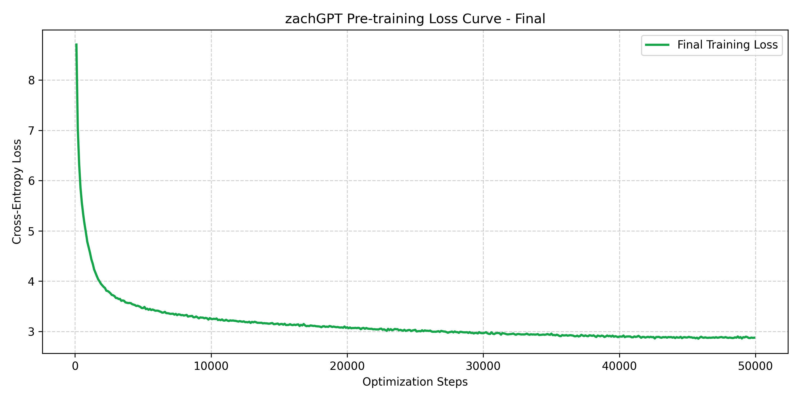

# Mini GPT from scratch

## Motivation 

I implemented a mini GPT using PyTorch, based on the paper Attention is All You Need along with various community tutorials and technical resources. A model pre-trained on about 800M tokens from French Wikipedia (trained on a single NVIDIA RTX 5060) is provided.

I am an engineering student who wanted to build an autoregressive GPT from scratch to understand the mathematical mechanics under the hood. With my mathematics background, but as an absolute novice in AI and deep learning, this repository is intended to anyone who wants to understand more about building GPT, and deep learning in general.

This repository is primarily intended for students starting from scratch who want to build their own Transformer model. You will find the file **THEORY.md**, in which you will learn everything you have to know to understand what is a GPT, how it works mathematically, and all the theory/choices I made in this architecture. Thus, it requires a certain knowledge of linear algebra, differential calculus and basic probabilities (undergraduate level).

## Architecture Overview

| Parameter | Value | Details |
| :--- | :--- | :--- |
| **Parameters** | $\sim 30\text{M}$ | Decoder-only Transformer |
| **Layers / Heads** | 6 / 8 | Multi-Head Causal Self-Attention |
| **Model Dimension ($d_{\text{model}}$)** | 512 | Head dim = 64 |
| **Max Sequence Length** | 256 tokens ||
| **Positional Encoding** | RoPE | 2D Rotary Position Embeddings |
| **Vocabulary** | 16,384 | Custom Byte-Pair Encoding (BPE) |


# Main results

The model is capable of completing prompts with French sentences, but most of the time it does not make sense as the text is generated. The final loss is around 2.9, without any other training or fine tuning, which is not the point of this repo.




Here are a few generation examples after only 6 hours of pre-training : 
```
Prompt : "La france est"

Answer : La france est une commune de la couronne. Cette aire, qui regroupe , est catégorisée dans les aires de ou plus (hors Paris).

Occupation des sols 
L'occupation des sols de la commune, telle qu'elle ressort de la base de données européenne d’occupation biophysique des sols Corine Land Cover (CLC), est marquée par l'importance des territoires agricoles (64,7 % en 2018), une proportion identique à celle de 1990 (64,7 %). La répartition détaillée en 2018 est la suivante : 
terres arables (39,2 %), forêts (39,4 %), zones urbanisées (7,6 %), prairies (0,1 %). L'évolution de l’occupation des sols de la commune et de ses infrastructures peut être observée sur les différentes représentations cartographiques du territoire : la carte de Cassini (), la carte d'état-major (1820-1866) et les cartes ou photos aériennes de l'IGN pour la période actuelle (1950 à aujourd'hui).

Toponymie 
Le nom de la localité est attesté sous les formes
```
```
Prompt : "Les mathématiques sont un ensemble de connaissances abstraites résultant de raisonnements logiques appliqués à des objets divers"
Answer : Les mathématiques sont un ensemble de connaissances abstraites résultant de raisonnements logiques appliqués à des objets divers. On peut citer par exemple les travaux de Joseph Millin, Friedrich Scherrer, Friedrich Scherrer, Friedrich Scherrer, Friedrich Scherrer, Michel de Côme, et Friedrich Scherrer, avec l'algèbre de Scherrer, Friedrich Scherrer, Scherrer, Friedrich Scherrer, Friedrich Scherrer, J.A. Simonski, Ernst Neubauer, Friedrich Scherrer et Ernst Scherrer.

Histoire 
La première période de l'école est marquée par l'utilisation d'un certain nombre de concepts mathématiques plus avancés que les mathématiques. Elle est la première figure de la théorie mathématique à avoir été formellement combinées avec les mathématiques et les mathématiques. Cette théorie est celle qui a eu des conséquences sur la logique mathématique et l'histoire des mathématiques. 

Selon ses biographes, "la théorie de la logique est une théorie", et "les mathématiques les plus modernes sont le calcul et la théorie de la logique" (Loi de Gauss pour les mathématiques, 1819).

Les mathématiques 

La théorie de la logique le place dans la théorie de la logique chez Scherrer. Elle est une des seules théorie sur des algèbres. Sous
```
```
Prompt : "En 1928, le gouvernement arménien intensifia la collectivisation forcée"
Answer : En 1928, le gouvernement arménien intensifia la collectivisation forcée de sa paysanne de culture. En 1930 il en fut ratifié et définitivement à partir de 1922 député d'Azizpan, au résultat de cette défaite. De 1930 à sa retraite de l'Égliseographes arménienne, il demeura à Istanbul. Après l'époque soviétique et la révolution d'Octobre pour l'alliance avec l'Église arménienne, en 1961 il rapprocha le statut des votes acquis des réformateurs aux libertés civiles. Il fut le grand-rabbin de Moscou de 1946 à 1983. Le régimetoral, dont il subsiste toujours une majorité, s'efforça de renoncer à tous les missions gouvernementales et les fait adopter dans des conditions coordonnées de sa politique. De 1947 à 1952 son successeur, Vladislav Malykovitch, fut également ministre plénipotentiaire en Russie, au sein de la comité du « sport » de Moscou.

Il meurt le  à Providence dans la baie de Munich. Il est inhumé au cimetière de Poliorcète.

Publications 

Concours de jeunes écrivains d’anniversaire (1927-1928) : « Les livres de poésie » ( domestique).
```

Brief analysis for non-French speakers: Almost every generated words exist in the French lexicon, and local grammatical agreements (such as adjective-noun gender and number matches) are always preserved. The model also reproduces standard Wikipedia formatting patterns (e.g., bulleted taxonomies, section headers like Notes et références or Articles connexes). While global semantic coherence breaks down quickly, sentences are readable, the language is almost correct.

# Installation
 

# Cloning repository and download model
```bash
git clone https://github.com/zachariamouhid-oss/mini-gpt-pytorch.git
cd mini-gpt-pytorch
```
# Create and activate virtual environment
```bash
python -m venv .venv
# On Linux/macOS
source .venv/bin/activate

# On Windows (PowerShell)
.venv\Scripts\activate
```
# Install dependencies 
```bash
# For a standard installation (CPU or GPU automatically detected)
pip install -r requirements.txt
```
If you have a NVIDIA GPU supporting CUDA, I recommend to install torch with this link https://pytorch.org/get-started/locally/

# Download model
Run *import_model.py* to download the pre-trained 30M parameters model zachGPT.

# Quickstart (Text Generation)

Run *generate.py* to try yourself the model.
Modify prompts or the temperature to get interesting results !

## Repository Structure

```text
zachGPT/
│
├── .gitignore               
├── LICENSE                 
├── requirements.txt        
│
├── README.md              
├── THEORY.md               
├── model_config.json       
├── tokenizer_wiki_16k.json  
│
├── model.py                
├── tokenizer.py            
├── torch_textdataset.py   
├── import_model.py         
├── generate.py            
├── pretrain_model.py      
├── resume_training.py     
│
└── assets/
    └── loss_curve.png    
```

[](https://www.python.org/downloads/)
[](https://pytorch.org/)
[](https://huggingface.co/Zacharia01/zachGPT-30M)

